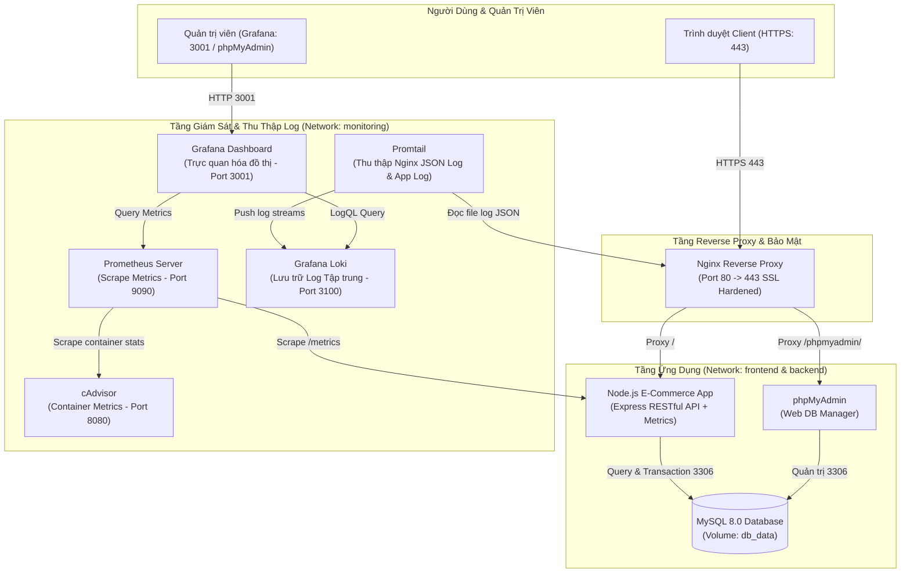

# BÁO CÁO ĐỒ ÁN / BÀI TẬP LỚN: TRIỂN KHAI HỆ THỐNG
# ĐỀ TÀI 9: WEBSITE THƯƠNG MẠI ĐIỆN TỬ (E-COMMERCE) & HỆ THỐNG GIÁM SÁT TẬP TRUNG
**Trường Đại học Công nghệ Thông tin và Truyền thông - Đại học Thái Nguyên (ICTU)**

---

## 1. Giới Thiệu Đề Tài & Mục Tiêu

Hệ thống được xây dựng nhằm cung cấp giải pháp toàn diện cho một nền tảng Thương mại điện tử (E-Commerce) hiện đại theo tiêu chuẩn DevOps & SRE (Site Reliability Engineering):
- **Ứng dụng bán hàng trực tuyến:** Cho phép khách hàng tìm kiếm, duyệt danh mục sản phẩm, quản lý giỏ hàng, đặt hàng theo thời gian thực (hỗ trợ kiểm tra tồn kho và Transaction cơ sở dữ liệu).
- **Cơ sở dữ liệu quan hệ bền vững:** Quản lý dữ liệu tập trung qua MySQL 8.0 kèm giao diện quản trị phpMyAdmin.
- **Bảo mật & Cân bằng tải:** Máy chủ Nginx đóng vai trò Reverse Proxy, định tuyến an toàn qua giao thức HTTPS (SSL tự ký), áp dụng đầy đủ các chuẩn **Security Hardening** (HSTS, CSP, X-Frame-Options, ẩn Server Version).
- **Giám sát thời gian thực (Full Observability Stack):** Thu thập Time-series Metrics bằng **Prometheus & cAdvisor**, thu thập nhật ký phân tán bằng **Loki & Promtail**, và trực quan hóa toàn bộ trên **Grafana**.

---

## 2. Kiến Trúc Hệ Thống (System Architecture)

Toàn bộ hệ thống gồm **9 dịch vụ** chạy độc lập trên các container Docker, được cô lập và liên kết thông qua 3 phân vùng mạng (`frontend`, `backend`, `monitoring`):



---

## 3. Danh Sách 9 Dịch Vụ & Bảng Ánh Xạ Cổng (Port Mapping)

| STT | Tên Dịch Vụ | Container Name | Vai Trò Kỹ Thuật | Cổng Truy Cập / URL |
| :---: | :--- | :--- | :--- | :--- |
| **1** | **Nginx** | `ecommerce_nginx` | Reverse Proxy, SSL Offloading, Security Hardening | `https://localhost` (HTTP: 80, HTTPS: 443) |
| **2** | **Node.js App** | `ecommerce_app` | Backend REST API, Frontend E-Commerce, Custom Metrics | `http://ecommerce_app:3000` (Nội bộ qua Nginx `/`) |
| **3** | **MySQL** | `ecommerce_db` | Lưu trữ dữ liệu danh mục, sản phẩm, đơn vị kho, đơn hàng | `db:3306` (Mạng nội bộ) |
| **4** | **phpMyAdmin** | `ecommerce_phpmyadmin` | Giao diện quản trị trực quan cơ sở dữ liệu MySQL | `https://localhost/phpmyadmin/` |
| **5** | **Prometheus** | `ecommerce_prometheus` | Thu thập & lưu trữ chỉ số time-series từ App và cAdvisor | `http://localhost:9090` |
| **6** | **cAdvisor** | `ecommerce_cadvisor` | Đo lường hiệu năng phần cứng CPU/RAM/IO của Docker | `http://localhost:8080` |
| **7** | **Loki** | `ecommerce_loki` | Hệ thống lưu trữ và đánh chỉ mục Log tập trung | `http://localhost:3100` |
| **8** | **Promtail** | `ecommerce_promtail` | Agent thu thập Nginx Access Log JSON & chuyển về Loki | Chạy ngầm trong mạng `monitoring` |
| **9** | **Grafana** | `ecommerce_grafana` | Dashboard trực quan hóa tổng hợp biểu đồ Metrics & Logs | `http://localhost:3001` (Tự động nạp DataSource) |

---

## 4. Cấu Trúc Thư Mục Dự Án (Project Structure)

```text
ecommerce-project/
├── .env                              # Biến môi trường hệ thống (Cấu hình DB, mật khẩu)
├── .env.example                      # File mẫu biến môi trường
├── docker-compose.yml                # File điều phối toàn bộ 9 dịch vụ Docker
├── README.md                         # Báo cáo và hướng dẫn triển khai đồ án ICTU
├── app/                              # Mã nguồn ứng dụng Node.js E-Commerce
│   ├── Dockerfile                    # Dockerfile tối ưu (chạy user node non-root)
│   ├── package.json                  # Khai báo dependencies (express, mysql2, prom-client)
│   ├── server.js                     # Backend API, MySQL retry logic, Prometheus Metrics, JSON log
│   └── public/                       # Giao diện người dùng Web Frontend
│       ├── index.html                # Giao diện mua sắm, giỏ hàng, thanh toán, quản lý
│       ├── styles.css                # Bộ nhận diện giao diện hiện đại, responsive
│       └── app.js                    # Logic tương tác giỏ hàng, lọc sản phẩm, gọi API
├── mysql/                            # Thư mục khởi tạo cơ sở dữ liệu
│   └── init.sql                      # Schema khởi tạo bảng (categories, products, orders) & seed data
├── nginx/                            # Cấu hình Reverse Proxy & SSL
│   ├── nginx.conf                    # Cấu hình HTTP->HTTPS, SSL, Hardening Headers, Log JSON
│   └── ssl/                          # Thư mục chứng chỉ bảo mật
│       ├── selfsigned.crt            # Chứng chỉ SSL tự ký
│       ├── selfsigned.key            # Khóa riêng tư SSL bí mật
│       ├── generate-ssl.sh           # Script sinh chứng chỉ tự động trên Linux/macOS
│       └── generate-ssl.ps1          # Script sinh chứng chỉ tự động trên Windows PowerShell
├── prometheus/                       # Cấu hình giám sát số liệu
│   └── prometheus.yml                # Cấu hình scrape interval, target: app, cadvisor, prometheus
├── loki/                             # Cấu hình hệ thống lưu trữ log
│   └── loki-config.yml               # Cấu hình storage, schema, tsdb
├── promtail/                         # Cấu hình agent thu thập log
│   └── promtail-config.yml           # Pipeline parse Nginx JSON Log và Docker container logs
└── grafana/                          # Cấu hình trực quan hóa
    └── provisioning/
        └── datasources/
            └── datasources.yml       # Tự động nạp sẵn Prometheus & Loki Datasource
```

---

## 5. Hướng Dẫn Cài Đặt & Triển Khai (Deployment Guide)

### Bước 1: Yêu cầu chuẩn bị
- Đã cài đặt **Docker Desktop** (bật WSL2 trên Windows) và **Git**.
- Đảm bảo các cổng `80`, `443`, `3001`, `9090`, `8080`, `3100` không bị chiếm dụng bởi phần mềm khác.

### Bước 2: Kiểm tra chứng chỉ SSL tự ký
Dự án đã sinh sẵn cặp khóa SSL `selfsigned.crt` và `selfsigned.key` trong thư mục `nginx/ssl/`. Nếu cần tái tạo chứng chỉ mới:
- **Trên Windows (PowerShell):**
  ```powershell
  cd nginx/ssl
  .\generate-ssl.ps1
  cd ../..
  ```
- **Trên Linux / Git Bash:**
  ```bash
  chmod +x nginx/ssl/generate-ssl.sh
  ./nginx/ssl/generate-ssl.sh
  ```

### Bước 3: Khởi chạy toàn bộ hệ thống bằng Docker Compose
Mở terminal tại thư mục gốc của dự án (`ecommerce-project`) và thực hiện:

```bash
docker-compose up -d --build
```

### Bước 4: Kiểm tra trạng thái hoạt động của 9 container
```bash
docker-compose ps
```
Tất cả 9 dịch vụ (`ecommerce_nginx`, `ecommerce_app`, `ecommerce_db`, `ecommerce_phpmyadmin`, `ecommerce_prometheus`, `ecommerce_cadvisor`, `ecommerce_loki`, `ecommerce_promtail`, `ecommerce_grafana`) đều phải ở trạng thái **`Up` / `running`**.

---

## 6. Hướng Dẫn Kiểm Thử Chức Năng (Functional Testing)

### 6.1. Trải nghiệm Website Bán Hàng Trực Tuyến
1. Mở trình duyệt và truy cập: **`https://localhost`**
   *(Lưu ý: Do sử dụng chứng chỉ tự ký nội bộ, trình duyệt sẽ đưa ra cảnh báo bảo mật ban đầu. Nhấn chọn **Nâng cao (Advanced)** -> **Tiếp tục truy cập localhost (Proceed to localhost)**).*
2. **Khám phá danh mục:** Bấm chọn các tab danh mục *Laptop & Máy tính*, *Điện thoại & Tablet*, *Phụ kiện công nghệ*, *Âm thanh*.
3. **Tìm kiếm sản phẩm:** Gõ từ khóa tìm kiếm (ví dụ: `iPhone`, `Keychron`, `Sony`) để xem phản hồi tìm kiếm tức thì.
4. **Giỏ hàng & Đặt hàng:**
   - Bấm nút **"Thêm giỏ"** tại sản phẩm bất kỳ.
   - Bấm nút **"Giỏ hàng"** ở góc phải thanh điều hướng để mở ngăn kéo giỏ hàng.
   - Nhấn **"Tiến hành Đặt hàng"**, điền thông tin người nhận (Họ tên, SĐT, Địa chỉ) và chọn hình thức thanh toán.
   - Nhấn **"Hoàn Tất Đặt Hàng"**: Hệ thống sẽ tự động thực thi **Database Transaction** trong MySQL (giảm số lượng tồn kho tương ứng, tạo bản ghi đơn hàng, ghi log giao dịch).
5. **Quản lý đơn hàng:** Bấm nút **"Đơn hàng"** trên menu để kiểm tra đơn hàng vừa tạo và thử cập nhật trạng thái đơn (Chờ xử lý, Đang giao, Hoàn thành).
6. **Thêm sản phẩm mới (Admin):** Bấm nút **"Thêm SP"** để nhập sản phẩm mới vào kho CSDL MySQL.

### 6.2. Quản trị Cơ sở Dữ liệu qua phpMyAdmin
1. Truy cập đường dẫn: **`https://localhost/phpmyadmin/`**
2. Đăng nhập với thông tin tài khoản MySQL (được cấu hình trong file `.env`):
   - **Tài khoản:** `ecommerce_user` (hoặc `root`)
   - **Mật khẩu:** `ecommerce_pass` (hoặc `supersecretroot`)
   - **Máy chủ:** `db`
3. Kiểm tra các bảng đã được nạp tự động qua `init.sql`: `categories`, `products`, `orders`, `order_items`.

---

## 7. Hướng Dẫn Giám Sát & Truy Vấn Log (Monitoring & Observability Guide)

### 7.1. Giám sát Metrics với Prometheus
Truy cập: **`http://localhost:9090`**
Vào menu **Status -> Targets**: Xác nhận các target `ecommerce-app` và `cadvisor` đều hiển thị trạng thái xanh **`UP`**.

**Các câu lệnh PromQL thử nghiệm thực tế:**
- Tổng số lượng request vào ứng dụng theo phương thức và mã trạng thái:
  ```promql
  http_requests_total
  ```
- Tần suất request mỗi giây (Throughput):
  ```promql
  rate(http_requests_total[1m])
  ```
- Tổng số đơn hàng thương mại điện tử đã được tạo:
  ```promql
  ecommerce_orders_total
  ```
- Tổng doanh thu bán hàng tích lũy:
  ```promql
  ecommerce_revenue_total
  ```
- Số lượng sản phẩm hiện có trong kho:
  ```promql
  ecommerce_products_count
  ```
- Mức tiêu thụ CPU của các container từ cAdvisor:
  ```promql
  rate(container_cpu_usage_seconds_total[1m])
  ```

### 7.2. Giám sát Tài nguyên Container với cAdvisor
Truy cập: **`http://localhost:8080`**
- Theo dõi trực quan biểu đồ tải CPU, RAM, Network I/O, File System I/O của từng container trong hệ thống (như `ecommerce_app`, `ecommerce_nginx`, `ecommerce_db`).

### 7.3. Trực quan hóa Tổng hợp trên Grafana
Truy cập: **`http://localhost:3001`**
- Tài khoản mặc định: `admin` / `admin` (lần đầu đăng nhập có thể chọn *Skip* đổi mật khẩu).
- Nguồn dữ liệu (**Datasources**) **Prometheus** và **Loki** đã được tự động nạp sẵn vào Grafana nhờ cơ chế Provisioning trong thư mục `grafana/provisioning/datasources/datasources.yml`.

**Xem Log thời gian thực (Loki LogQL):**
1. Vào menu **Explore** trên thanh bên trái của Grafana.
2. Chọn nguồn dữ liệu **Loki**.
3. Nhập câu lệnh truy vấn LogQL:
   - Xem toàn bộ log Nginx định dạng JSON:
     ```logql
     {job="nginx"}
     ```
   - Lọc các request có mã phản hồi thành công hoặc lỗi:
     ```logql
     {job="nginx"} | json | status >= 400
     ```
   - Xem log của ứng dụng Node.js trong Docker container:
     ```logql
     {job="docker"}
     ```

**Thêm Dashboard cAdvisor chuyên nghiệp:**
1. Vào **Dashboards** -> **New** -> **Import**.
2. Nhập ID Dashboard mẫu nổi tiếng của cAdvisor: **`14282`** (hoặc **`893`** hoặc **`10619`**).
3. Chọn Data source là **Prometheus** -> Bấm **Import**. Toàn bộ hiệu năng chi tiết của hệ thống Docker sẽ hiển thị trực quan đẹp mắt.

---

## 8. Báo Cáo Kỹ Thuật Bảo Mật (Security Hardening)

Hệ thống được thiết kế tuân thủ các chuẩn an toàn thông tin khắt khe:

1. **Bảo mật tầng Reverse Proxy (Nginx):**
   - **Tự động chuyển hướng:** Mọi kết nối không an toàn qua cổng `80` (HTTP) đều được chuyển hướng vĩnh viễn (301) sang cổng `443` (HTTPS).
   - **Ẩn thông tin phiên bản (`server_tokens off;`):** Ngăn chặn kẻ tấn công dò quét phiên bản máy chủ Nginx để khai thác lỗ hổng bảo mật đã biết.
   - **Các HTTP Security Headers:**
     - `Strict-Transport-Security (HSTS)`: Ép trình duyệt luôn kết nối HTTPS trong 31536000 giây (1 năm).
     - `X-Frame-Options "SAMEORIGIN"`: Phòng chống tấn công Clickjacking.
     - `X-Content-Type-Options "nosniff"`: Ngăn chặn trình duyệt đoán sai định dạng MIME (MIME Sniffing).
     - `X-XSS-Protection "1; mode=block"`: Kích hoạt bộ lọc chống Cross-Site Scripting của trình duyệt.
     - `Referrer-Policy "strict-origin-when-cross-origin"`: Kiểm soát thông tin đường dẫn người dùng khi chuyển hướng.
     - `Permissions-Policy "camera=(), microphone=(), geolocation=()"`: Vô hiệu hóa quyền truy cập thiết bị phần cứng nhạy cảm.

2. **Bảo mật Container (Docker Hardening):**
   - Ứng dụng Node.js chạy dưới quyền người dùng không đặc quyền (`USER node`), không chạy dưới quyền `root` để phòng ngừa lỗ hổng Container Escape.
   - Các file cấu hình hệ thống (`nginx.conf`, `prometheus.yml`, `loki-config.yml`, `init.sql`) đều được mount ở chế độ chỉ đọc (`:ro - read-only`).
   - Phân chia 3 mạng nội bộ riêng biệt: `frontend` (giao tiếp người dùng), `backend` (cơ sở dữ liệu biệt lập), `monitoring` (hệ thống giám sát).

---

## 9. Xử Lý Các Sự Cố Thường Gặp (Troubleshooting)

1. **Lỗi đụng độ cổng (Port Conflict - ví dụ: Port 80, 443 hoặc 3306 đã có service khác dùng):**
   - Kiểm tra tiến trình đang chiếm cổng:
     ```powershell
     netstat -ano | findstr :80
     ```
   - Tắt dịch vụ IIS (nếu có trên Windows): Mở PowerShell quyền Administrator chạy `iisreset /stop` hoặc tắt dịch vụ Skype/Apache đang chạy trên máy chủ.
   - Hoặc chỉnh sửa cổng Nginx trong file `docker-compose.yml` thành `"8081:80"` và `"8443:443"`.

2. **Khởi động lại toàn bộ hoặc xóa dữ liệu để nạp lại từ đầu:**
   ```bash
   # Dừng và xóa toàn bộ container cùng volumes dữ liệu
   docker-compose down -v

   # Khởi động lại và build lại
   docker-compose up -d --build
   ```

3. **Xem trực tiếp nhật ký container khi có lỗi:**
   ```bash
   docker logs ecommerce_app -f
   docker logs ecommerce_nginx -f
   docker logs ecommerce_db -f
   ```

---
*Báo cáo được hoàn thiện chi tiết phục vụ chấm điểm đồ án / bài tập lớn học phần DevOps & Triển khai Hệ thống - ICTU.*
